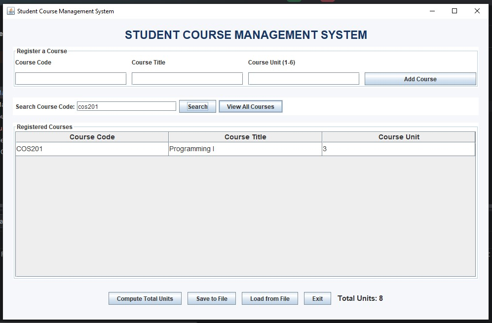
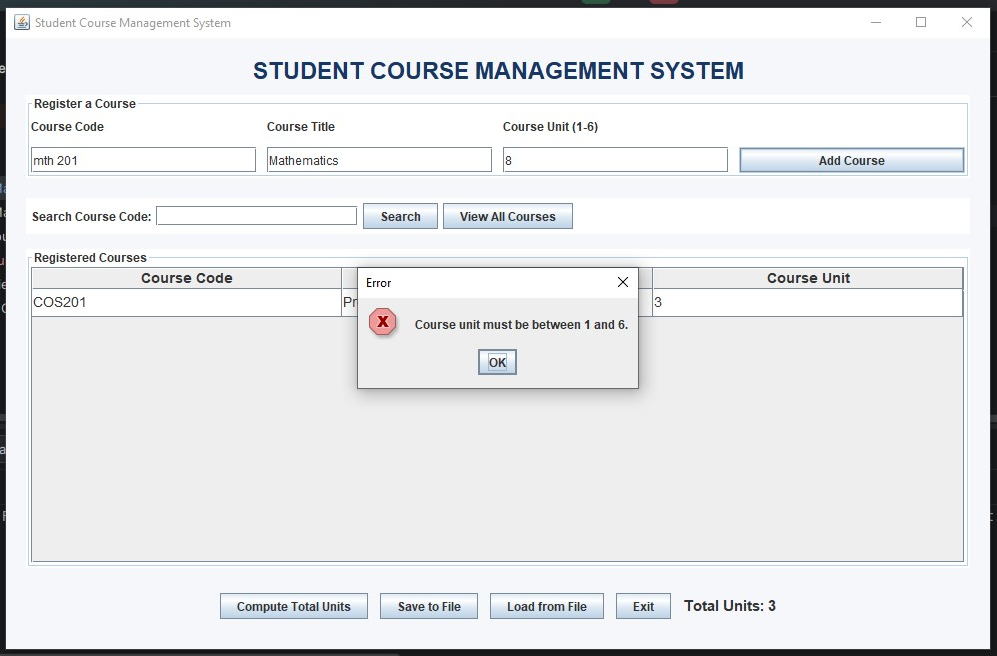
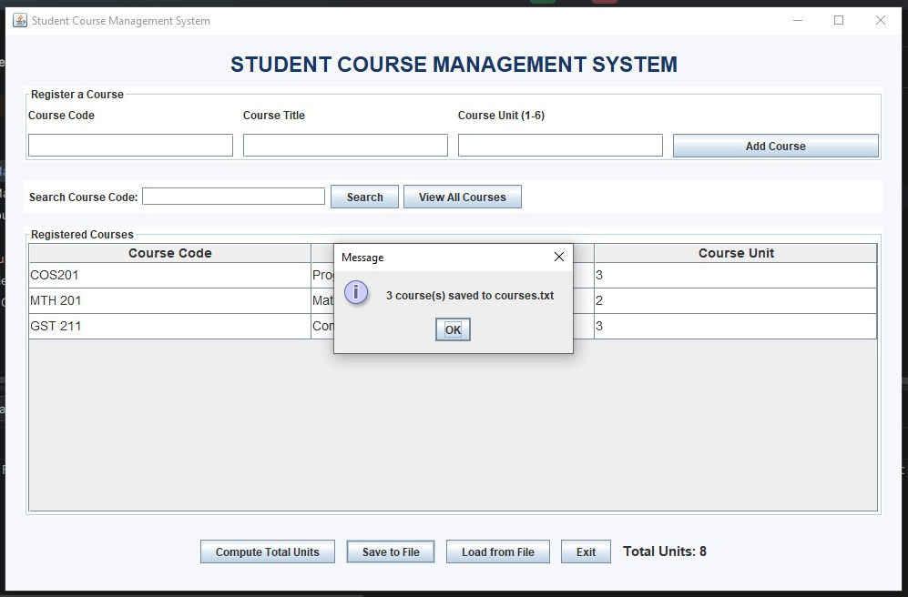

# Student Course Management System

A simple Java desktop application (Swing GUI) that helps a student record and manage the courses they are taking for a semester. Built for the **COS 201 Programming I** mid-semester lab assessment at **Miva Open University**.


## Table of Contents
- [Features](#features)
- [Screenshots](#screenshots)
- [Project Structure](#project-structure)
- [Getting Started](#getting-started)
- [How to Use](#how-to-use)
- [Input Validation Rules](#input-validation-rules)
- [Save File Format](#save-file-format)
- [How It Works](#how-it-works)
- [Concepts Demonstrated](#concepts-demonstrated)
- [Author](#author)

## Features

| # | Operation | Description |
|---|-----------|-------------|
| 1 | **Add Course** | Add a course with a code, title and unit. |
| 2 | **View All Courses** | Display every stored course in a table. |
| 3 | **Search Course by Code** | Find a course by its code (not case-sensitive). |
| 4 | **Compute Total Units** | Calculate and display the total credit units. |
| 5 | **Save to File** | Save all courses to `courses.txt`. |
| 6 | **Load from File** | Load previously saved courses from `courses.txt`. |
| 7 | **Exit** | Close the program (asks for confirmation first). |

## Screenshots

| Search by code | Invalid input | Save to file |
|---|---|---|
|  |  |  |

## Project Structure

```
student-course-management-system/
├── src/
│   ├── Course.java                 # The course object (code, title, unit)
│   ├── InvalidCourseException.java # Custom exception for invalid input
│   ├── CourseManager.java          # Stores courses and performs all operations
│   └── CourseManagementGUI.java    # Swing user interface and program entry point
├── screenshots/
└── README.md
```

| File | Responsibility |
|------|----------------|
| `Course.java` | Holds one course's code, title and unit using private fields and getters. |
| `InvalidCourseException.java` | Thrown when course data fails validation. |
| `CourseManager.java` | Keeps the course list in an `ArrayList` and handles adding, searching, totalling, saving and loading. Contains no GUI code. |
| `CourseManagementGUI.java` | Builds the window and sends each button click to the right operation. Contains `main`. |

## Getting Started

### Requirements
- Java Development Kit (JDK) 8 or later

### Download
```bash
git clone https://github.com/Emmy81/student-course-management-system.git
cd student-course-management-system
```

### Compile and run (command line)
```bash
cd src
javac *.java
java CourseManagementGUI
```

### Run in an IDE
Open the project in IntelliJ IDEA (or any Java IDE), then run the `main` method in `CourseManagementGUI.java`.

## How to Use

1. **Add a course:** type the course code (for example `COS 201`), the course title and the unit, then click **Add Course**. The table updates automatically.
2. **View all courses:** click **View All Courses** to show the full list again (for example after a search).
3. **Search:** type a code in the **Search Course Code** box and click **Search**. If the code does not exist you will see "Course not found".
4. **Total units:** click **Compute Total Units**. The total also appears next to the buttons.
5. **Save:** click **Save to File** to write all courses to `courses.txt`.
6. **Load:** click **Load from File** to replace the current list with the courses in `courses.txt`.
7. **Exit:** click **Exit** (or close the window) and confirm.

## Input Validation Rules

Invalid input is rejected with a clear error message and nothing is stored.

| Field | Rule |
|-------|------|
| All fields | Must not be empty. |
| Course code | 2 to 4 letters followed by 3 digits, such as `COS 201` or `COS201`. Converted to upper case and extra spaces are removed. |
| Course title | Extra spaces are trimmed. The `\|` character is not allowed because it is used in the save file. |
| Course unit | A whole number from 1 to 6. |
| Duplicates | A course code that already exists cannot be added again. |

## Save File Format

Courses are saved in `courses.txt` (in the folder the program is run from), one course per line:

```
CODE|TITLE|UNIT
```

Example:

```
COS201|Programming I|3
MTH 201|Mathematics|3
GST 211|Communication|3
```

When loading, any line that is badly formatted or invalid is skipped, and the program tells you how many records were skipped. A missing file shows a clear message instead of crashing.

## How It Works

- **Menu selection:** every button calls `handleMenuChoice()`, which uses a `switch` statement to decide which operation to run.
- **Recursion:** two operations are recursive.
  - `searchRecursively()` checks the course at the current index, returns it if the code matches, returns nothing at the end of the list, and otherwise calls itself with `index + 1`.
  - `totalUnitsRecursively()` returns `0` at the end of the list, and otherwise adds the current course's units to the total of the remaining courses.
- **Iteration:** loops are used to fill the table, write the file and read the file line by line.
- **Exceptions:** `InvalidCourseException` reports validation problems, `NumberFormatException` is handled for non-numeric units, and `FileNotFoundException` / `IOException` are handled for file operations.
- **String processing:** input is trimmed, converted to upper case and checked against the allowed format.

## Concepts Demonstrated

Classes and objects, encapsulation, collections (`ArrayList`), methods, conditional logic (`switch`, `if`), loops, recursion, exception handling, string processing, file input/output, and a Swing graphical user interface.

## Author

**Chikaodili Emmanuel Kelechi**
BSc Computer Science, Miva Open University
COS 201 Programming I, Mid-Semester Lab Assessment
